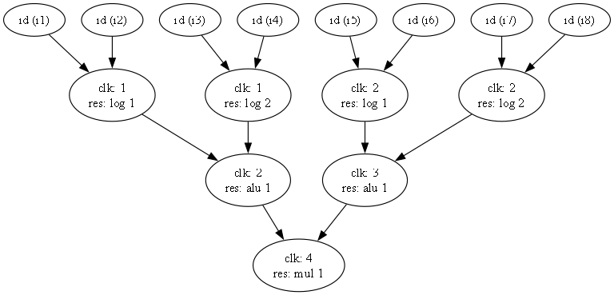

# CA-5 · Expression-to-Verilog Scheduling Tool

[← Repository overview](../README.md)

A small high-level synthesis tool that takes an arithmetic/bitwise expression, builds a **data-flow graph (DFG)**, schedules its operations, and generates a **32-bit Verilog datapath, controller, top module, and testbench**.

## Pipeline

```text
input.json → Python AST → data-flow graph → schedule + resource assignment
                                                   ↓
                            graph images + output.json + Verilog
```

The generated datapath shares functional units across scheduled cycles. Multiplexers select their inputs, intermediate registers retain operation results, and an FSM controls each cycle.

| Resource | Operations emitted by the generator |
| --- | --- |
| `ALU` | Addition and subtraction |
| `MUL` | Multiplication and division |
| `LOG` | Bitwise AND, OR, and XOR; see parser limits below |

## Scheduling modes

- **Resource-constrained latency scheduling:** select ready operations in node-ID order, using the available number of each resource per cycle.
- **Latency-constrained resource scheduling:** prioritize operations using latest-start times (ALAP), start with one unit of each type, and increase counts until the target latency is met or the search limit is reached.

These are heuristic list schedulers, not proofs of a globally optimal solution. Each operation occupies one scheduled cycle, including multiplication and division; physical timing and multi-cycle operator latency are not modeled. In the latency-constrained mode, the implementation starts its own resource search rather than treating `Config.Resources` as a hard cap.

## Run an example

Requirements: Python 3.9 or later, the Python `graphviz` package, and a Graphviz installation with `dot` on `PATH`. Run from `CA-5`:

```text
python -m pip install graphviz
dot -V
python main.py samples/sample1
```

The Python package alone does not install the Graphviz executable. The command takes a **folder containing `input.json`**, not the JSON filename.

[Sample 1](samples/sample1/input.json) contains:

```json
{
  "Expression": "((i1 & i2) + (i3 & i4)) * ((i5 & i6) + (i7 & i8))",
  "Algorithm": "MinLatencyResourceConstrained",
  "Config": {
    "MaxTime": 100,
    "Resources": { "ALU": 1, "MUL": 1, "LOG": 2 }
  }
}
```

Use `MinResourceLatencyConstrained` for the latency-constrained mode. The current dispatcher selects that mode only for the exact string; every other value selects the latency scheduler. Match the sample spelling for clarity.

### Generated files

| Output | Contents |
| --- | --- |
| `output.json` | Node IDs mapped to clock steps, resource types, and resource numbers |
| `pics/DFG.png` | Expression graph |
| `pics/ScheduledDFG.png` | Graph annotated with scheduling information |
| `codes/Datapath.v` | Shared functional units, multiplexers, and result registers |
| `codes/Controller.v` | FSM and per-cycle control signals |
| `codes/TopModule.v` | `topModule` integration with start/done interface |
| `codes/tbTopModule.v` | Random-input comparison against an expression-based expected result |

Running the tool overwrites these outputs in the selected sample and also copies generated Verilog into `samples/Code-test/codes/`. The ten checked-in sample folders include `correct_output.json` files for reference; the CLI does not automatically compare schedules against them.

## Inspect or simulate



After generating a sample, open its `codes/` directory in ModelSim/Questa and run:

```tcl
vlib work
vlog *.v
vsim work.tbTopModule
run -all
```

The generator emits a testbench that checks one random input assignment and prints `Test PASSED` or `Test FAILED`. Compile one sample at a time because generated module names are shared. Some archived samples use lowercase `datapath.v` and `controller.v`; the current generator writes capitalized filenames.

## Code guide and current limits

- [main.py](main.py): JSON input, pipeline orchestration, output writing, and the `VerilogGenerator` class.
- [src/dfg_creator.py](src/dfg_creator.py): operator/identifier nodes and AST-to-DFG construction.
- [src/scheduler.py](src/scheduler.py): dependency checks, list scheduling, ALAP priorities, and resource assignment.
- [src/graph_visualizer.py](src/graph_visualizer.py): Graphviz rendering before and after scheduling.

For end-to-end use, write binary expressions over named inputs using `+`, `-`, `*`, `/`, `&`, and `|`. Numeric literals and unary expressions are not handled by the DFG builder. XOR is emitted by the generator but absent from the builder's operator map; modulo is recognized by the builder but lacks a matching generated functional-unit operation. Avoid both until those stages are aligned. Provide at least one resource for each required operation type in resource-constrained mode, and avoid zero divisors when testing division.

## What I practiced

- Parsing expressions and representing data dependencies as a graph.
- Scheduling dependent operations under resource or latency constraints.
- Binding operations to shared functional units.
- Generating coordinated datapaths and finite-state controllers.
- Visualizing schedules and generating functional testbenches.

[Assignment specification](CAD-F04-CA5.pdf) · [All sample projects](samples/)
